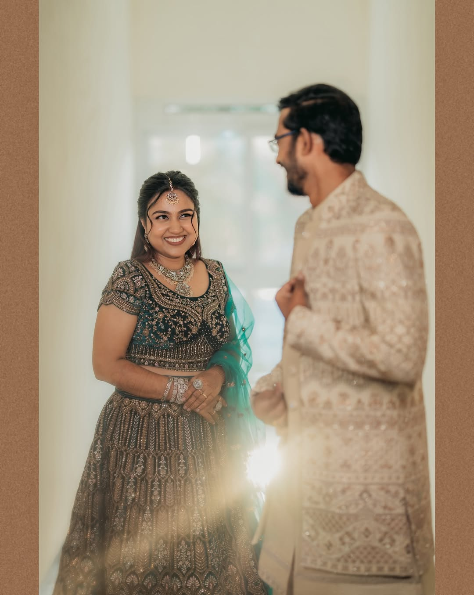
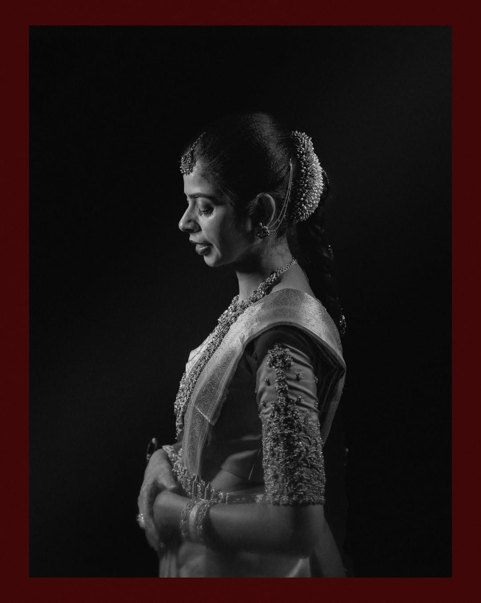

# Memory Portraits By Nandhu — Photography Portfolio Website

A premium, image-first, fully static portfolio website for **Memory Portraits By Nandhu**, a photography studio in Kollampalayam, Tamil Nadu, covering weddings (as *Memory Portraits By Nandhu*) and newborn, maternity, toddler and kids photography (as *Little Memory Portraits*).

Built with plain **HTML5, CSS3 and vanilla JavaScript**. No build step, no framework, no backend. Open `index.html` in a browser or upload the folder to any static host and it works.

---

## Contents

1. [Project structure](#project-structure)
2. [Quick start](#quick-start)
3. [Studio details and where they live](#studio-details-and-where-they-live)
4. [Replacing the images](#replacing-the-images)
5. [Changing phone / WhatsApp](#changing-phone--whatsapp)
6. [Adding an email address](#adding-an-email-address)
7. [Changing the Instagram links](#changing-the-instagram-links)
8. [Adding the website URL (SEO)](#adding-the-website-url-seo)
9. [Editing the copy](#editing-the-copy)
10. [The gallery system](#the-gallery-system)
11. [Deploying to GitHub Pages](#deploying-to-github-pages)
12. [Deploying to Netlify or Vercel](#deploying-to-netlify-or-vercel)
13. [Design system reference](#design-system-reference)
14. [Browser support and accessibility](#browser-support-and-accessibility)

---

## Project structure

```text
photography-portfolio/
│
├── index.html            Home
├── weddings.html         Weddings (dark, cinematic theme)
├── newborn.html          Little Memories hub + Newborn
├── maternity.html        Maternity
├── toddlers.html         Toddlers & Kids  (#kids anchor for the Kids section)
├── about.html            About the studio
├── contact.html          Contact details, enquiry form, Find Us
│
├── css/
│   └── style.css         All styles (design tokens at the top)
│
├── js/
│   └── main.js           All behaviour (STUDIO_CONFIG at the top)
│
├── assets/
│   ├── images/
│   │   ├── hero/         Full-screen hero images (desktop + mobile crops)
│   │   ├── weddings/     wedding-01.jpg … wedding-20.jpg, wedding-22 … 24.jpg
│   │   ├── newborn/      newborn-01 … 06, 08, 09, 10, 13.jpg
│   │   ├── maternity/    maternity-01, 02, 03, 05.jpg
│   │   ├── toddlers/     toddler-01 … 03, 05 … 16.jpg
│   │   ├── about/        about-photographer.jpg, about-studio.jpg
│   │   ├── placeholders/ Generic fallbacks you can copy from (unused)
│   └── icons/            favicon.svg and standalone SVG icons
│
└── README.md
```

---

## Quick start

1. Download or clone the folder.
2. Double-click `index.html`, or serve the folder with any static server.
3. The studio's own photographs from its two Instagram accounts are already in place, and so are the studio name, address, phone and Instagram links. See below to add or swap any photo.

Every image under `assets/images/` is a real photograph from the studio's Instagram accounts. `assets/images/IMAGE-SOURCES.md` lists which original file each one came from and where it is used. The three files in `assets/images/placeholders/` are generic fallbacks and are not used by any page.

---

## Studio details and where they live

Verified business information used throughout the site:

| Detail | Value |
|---|---|
| Studio | Memory Portraits By Nandhu |
| Address | AK Square, 95/1, Gandhiji Street, Karur Rd, Kollampalayam, Tamil Nadu 638002, India |
| Phone / WhatsApp | +91 97519 47133 (WhatsApp links use `919751947133`) |
| Instagram (weddings) | https://www.instagram.com/memory_portraits_by_nandhu/ shown as *Memory Portraits By Nandhu* |
| Instagram (babies & family) | https://www.instagram.com/little_memoryportraits/ shown as *Little Memory Portraits* |
| Email, website | Not yet available. Left empty on purpose; nothing is invented. |

The single source of truth for phone, WhatsApp, address, email and website is the block at the top of `js/main.js`:

```js
const STUDIO_CONFIG = {
    name: "Memory Portraits By Nandhu",
    phone: "+91 97519 47133",
    whatsapp: "919751947133",
    address: "AK Square, 95/1, Gandhiji Street, Karur Rd, Kollampalayam, Tamil Nadu 638002, India",
    weddingInstagram: "https://www.instagram.com/memory_portraits_by_nandhu/",
    littleMemoriesInstagram: "https://www.instagram.com/little_memoryportraits/",
    email: "",
    website: ""
};
```

Every element marked `data-config="whatsapp"`, `data-config="phone"`, `data-config="maps"` or `data-config="email"` is filled from this block when the page loads. The same real values are also written directly into the HTML as a fallback, so links work even without JavaScript.

No photographer name, awards, experience claims, client counts, testimonials or prices appear anywhere on the site. Add such content only if it is true and you want it published.

---

## Replacing the images

The site uses photographs downloaded from the studio's two Instagram accounts (September 2026); `assets/images/IMAGE-SOURCES.md` maps every file back to its original. Instagram re-compresses everything to 1080–1440px, so for the sharpest result replace them over time with the studio's own exported files, keeping the same filenames.

### Getting the originals

* **From the studio's archive** (best quality): export the selected photos as JPG, long edge 2000px or more.
* **From Instagram**: log in to the account → *Settings → Accounts Center → Your information and permissions → Download your information*. The export contains every uploaded photo as a JPG.
* **From Google Business Profile**: in the profile manager, open *Photos* and download the ones you want.

Only use photographs the studio owns or has permission to publish.

### Fastest way in: the ingest script

`tools/ingest-photos.ps1` resizes and renames a folder of originals into the exact filenames the pages use.

1. Run it once to create the folders:
   ```powershell
   .\tools\ingest-photos.ps1
   ```
2. Copy the originals into `tools/incoming/weddings`, `newborn`, `maternity`, `toddlers` (any names; sorted by filename, so prefix `01-`, `02-` to control order), plus named files into `hero/` (`hero-home.jpg`, `hero-wedding.jpg`, …) and `about/` (`about-photographer.jpg`, `about-studio.jpg`).
3. Preview, then run:
   ```powershell
   .\tools\ingest-photos.ps1 -DryRun
   .\tools\ingest-photos.ps1
   ```
   Defaults: long edge 1920px, JPEG quality 82. Originals are never modified.

The rest of this section explains the layout if you prefer to place files by hand.

### By hand

Every image lives under `assets/images/` and is referenced by a descriptive filename. To replace a photo, **save your photograph over the placeholder with exactly the same filename**. No HTML changes are needed.

| Folder | Files | Used on |
|---|---|---|
| `hero/` | `hero-home.jpg`, `hero-wedding.jpg`, `hero-little-memories.jpg`, `hero-maternity.jpg`, `hero-toddlers.jpg`, `hero-about.jpg`, `hero-contact.jpg` | Full-screen hero of each page |
| `hero/` | `*-mobile.jpg` versions of the five main heroes | Portrait crop shown on phones (under 768px) |
| `weddings/` | `wedding-01.jpg` → `wedding-20.jpg`, `wedding-22.jpg` | Weddings page, home page, about page |
| `newborn/` | `newborn-01` → `06`, `08`, `09`, `10`, `13` | Newborn page, home page |
| `maternity/` | `maternity-01`, `02`, `03`, `05` | Maternity page, home page |
| `toddlers/` | `toddler-01` → `03`, `05` → `15` (`16` is a spare) | Toddlers page, home page |
| `about/` | `about-photographer.jpg`, `about-studio.jpg` | About page, home page |

### Recommended sizes

| Use | Orientation | Suggested size | Notes |
|---|---|---|---|
| Hero (desktop) | Landscape 16:9 | 1920 × 1080 | Keep the subject away from the bottom-left where the text sits |
| Hero (mobile) | Portrait 2:3 | 1080 × 1620 | Only needed for the five main heroes |
| Gallery portrait | 3:4 | 1200 × 1600 | |
| Gallery landscape | 3:2 | 1600 × 1067 | |
| Gallery wide / large | 16:9 | 1920 × 1080 | |

Almost all Instagram photos are 4:5 portraits, so most gallery figures now use the `portrait` size class (see [The gallery system](#the-gallery-system)). Galleries use `object-fit: cover`, so a photo of a different ratio will still fill its slot, just cropped from the centre. Some gallery slots that had no real photo were removed from the pages; `assets/images/IMAGE-SOURCES.md` lists them and how to bring one back.

### Keep the files small

Photography sites get heavy fast. Export JPGs at **quality 75–82**, resize to the sizes above (never upload camera originals) and consider converting to WebP. Aim for under 300 KB per gallery image and under 500 KB per hero.

### Adding, removing or reordering photos

Each photo is one `<figure class="gallery-item …">` block in the HTML. Copy a block, change the two image paths (the `href` and the `src`), the `alt` text and the caption. See [The gallery system](#the-gallery-system) for the size modifiers.

### Optional: `srcset` for responsive gallery images

If you export multiple sizes, add a `srcset` and `sizes` to any ``:

```html

```

The hero images already use `<picture>` to serve the mobile crop on phones.

---

## Changing phone / WhatsApp

Edit `phone` and `whatsapp` in `STUDIO_CONFIG` (`js/main.js`).

* `whatsapp` — international format with **no `+`, spaces or dashes**, e.g. `"919751947133"`.
* `phone` — how the number is displayed.

Every WhatsApp button (header icon, mobile menu, footer, CTAs, contact page, enquiry form) and every phone link reads from these two values. For the no-JavaScript fallback, also find-and-replace `919751947133` and `+91 97519 47133` across the `.html` files.

The enquiry form's *Send via WhatsApp* button opens WhatsApp with the completed form pre-filled as a message.

---

## Adding an email address

Set `email` in `STUDIO_CONFIG`. As soon as it is non-empty:

* the *Send via Email* button appears on the enquiry form (it opens the visitor's mail app with the form contents), and
* any element marked `data-config="email"` gets a `mailto:` link.

While it is empty those elements stay hidden, so nothing invented is shown.

---

## Changing the Instagram links

The two Instagram URLs are written directly in the HTML so they work without JavaScript, and mirrored in `STUDIO_CONFIG`:

```text
https://www.instagram.com/memory_portraits_by_nandhu/   Memory Portraits By Nandhu (weddings)
https://www.instagram.com/little_memoryportraits/       Little Memory Portraits (babies & family)
```

To change one, find-and-replace the full URL across all `.html` files and update the config.

---

## Adding the website URL (SEO)

No domain has been confirmed yet, so pages currently carry a title, meta description, Open Graph type/site name/title/description and a Twitter card, but **no canonical link, `og:url` or `og:image`**, because those require an absolute URL.

Once the site has a domain, add to each page's `<head>` (replace the page name and hero image accordingly):

```html
<link rel="canonical" href="https://www.example.com/index.html">
<meta property="og:url" content="https://www.example.com/index.html">
<meta property="og:image" content="https://www.example.com/assets/images/hero/hero-home.jpg">
```

and set `website` in `STUDIO_CONFIG`.

---

## Editing the copy

All copy is deliberately generic and honest. Adjust it in the HTML, keeping paragraphs short so the photographs stay the focus. Two collection names are used consistently and should stay that way:

* **Memory Portraits By Nandhu** — the studio, and the wedding collection.
* **Little Memory Portraits** — the newborn, maternity, toddler and kids collection (never shown as the main studio name).

---

## The gallery system

Galleries are CSS Grid: 6 columns on desktop, 2 on mobile, with dense packing so items fill gaps. Each item gets a size modifier:

| Class | Desktop (6 cols) | Mobile (2 cols) | Best for |
|---|---|---|---|
| *(none)* | 2 × 1 | 1 × 1 | Any photo, small |
| `portrait` | 2 × 2 | 1 × 2 | Portrait photos |
| `landscape` | 3 × 1 | 2 × 1 | Landscape photos |
| `wide` | 4 × 1 | 2 × 1 | Cinematic / panoramic |
| `large` | 4 × 2 | 2 × 2 | The hero shot of a set |
| `tall` | 3 × 2 | 1 × 2 | Big portrait |

Rows of 6 columns pack cleanly with combinations such as `large + portrait`, `landscape + landscape`, `wide + default`, `tall + tall`, `portrait + portrait + portrait` or three defaults.

Markup for one item:

```html
<figure class="gallery-item portrait">
    <a class="gallery-item__link" href="assets/images/weddings/wedding-03.jpg">
        
        <figcaption class="gallery-item__caption">
            <span><span class="gallery-item__label">The Details</span><span class="gallery-item__title">Jewellery</span></span>
            <span class="gallery-item__icon"><svg class="icon" viewBox="0 0 24 24" aria-hidden="true"><path d="M5 12h14M13 6l6 6-6 6"/></svg></span>
        </figcaption>
    </a>
</figure>
```

* Any container with `data-gallery` becomes a **lightbox group**: click opens the viewer, arrows / swipe move between photos in that group, `Esc` closes.
* Add `gallery--soft` for gently rounded corners (used on the newborn page) and `gallery--spacious` for wider gaps.
* Add `reveal-stagger` to fade items in one after another as they scroll into view.

---

## Deploying to GitHub Pages

1. Create a new repository on GitHub (for example `memory-portraits`).
2. Upload the contents of this folder so that `index.html` is at the root of the repository.
   ```bash
   cd photography-portfolio
   git init
   git add .
   git commit -m "Initial portfolio site"
   git branch -M main
   git remote add origin https://github.com/YOUR-USERNAME/memory-portraits.git
   git push -u origin main
   ```
3. On GitHub open **Settings → Pages**.
4. Under *Build and deployment* choose **Deploy from a branch**, select `main` and the `/ (root)` folder, then save.
5. After a minute the site is live at `https://YOUR-USERNAME.github.io/memory-portraits/`.

All paths in the site are relative (`css/style.css`, `assets/images/…`), so it works in a sub-folder like this as well as on a custom domain. To use a custom domain, add it in the same Pages settings screen and follow GitHub's DNS instructions, then complete the [SEO step](#adding-the-website-url-seo).

---

## Deploying to Netlify or Vercel

* **Netlify:** drag the folder onto [app.netlify.com/drop](https://app.netlify.com/drop), or connect the Git repository. No build command; publish directory is the root.
* **Vercel:** import the repository, framework preset *Other*, no build command, output directory left blank.
* **Any web host:** upload the folder via FTP / file manager. Nothing else is required.

---

## Design system reference

All visual tokens are CSS variables at the top of `css/style.css`:

```css
:root {
    --color-bg: #f5f1eb;        /* warm ivory */
    --color-bg-alt: #ece6dd;    /* soft beige */
    --color-dark: #171615;      /* deep charcoal */
    --color-muted: #756f68;     /* muted text */
    --color-accent: #a18b6f;    /* tan accent */

    --font-display: "Cormorant Garamond", serif;
    --font-body: "DM Sans", sans-serif;
}
```

* Fonts load from Google Fonts. To self-host, download the two families and update the `@font-face` / `<link>` accordingly.
* The Weddings page uses `<body class="theme-dark">`, which swaps the semantic colours for a dark palette. Add that class to any page you want dark.
* Motion (preloader, scroll reveal, hover zoom, page fade) is fully disabled when the visitor's system requests reduced motion.

### Main components

| Class | Purpose |
|---|---|
| `.hero`, `.hero--page`, `.hero--compact`, `.hero--soft` | Full-screen / shorter heroes, soft overlay variant |
| `.statement` | Large serif editorial statement with offset aside |
| `.feature`, `.feature--reverse` | Split image + text with overlapping secondary image |
| `.categories`, `.category-feature` | Asymmetric category blocks on the home page |
| `.gallery`, `.gallery-item` | The gallery system described above |
| `.chapter` | Numbered gallery section heading |
| `.image-break` | Full-bleed photo with centred quote |
| `.values`, `.value` | Numbered list rows (About, Little Memories) |
| `.story` | Alternating image + text storytelling row |
| `.instagram` | Image strip + follow buttons |
| `.contact-cta` | Full-bleed dark call to action |
| `.enquiry-form` | Contact form |
| `.find-us` | Address card with Google Maps link (contact page) |

---

## Browser support and accessibility

* Works in all current browsers. Older browsers without `IntersectionObserver` simply show everything without reveal animations.
* Fully usable without JavaScript: navigation, images, WhatsApp, phone and map links work; gallery images open directly.
* Keyboard: skip link, visible focus states, lightbox with arrow keys and `Esc`, focus returned to the opening image on close.
* Screen readers: semantic landmarks, `aria-label`s on icon buttons, `aria-current` on the active nav item, descriptive `alt` text (decorative background photos have empty `alt`).
* Respects `prefers-reduced-motion`.

---

## Notes

* The enquiry form does **not** send anything to a server. It validates in the browser, then opens WhatsApp (or, once an email is configured, the visitor's email app) with the message pre-filled. If you later want direct form submissions, services such as Formspree or Netlify Forms can be added with a small change to the `<form>` tag.
* Instagram is linked, not embedded, so the site never depends on Instagram's API and stays fast.
* The Google Maps link is a search for the studio's name and address, so no coordinates are hard-coded.
